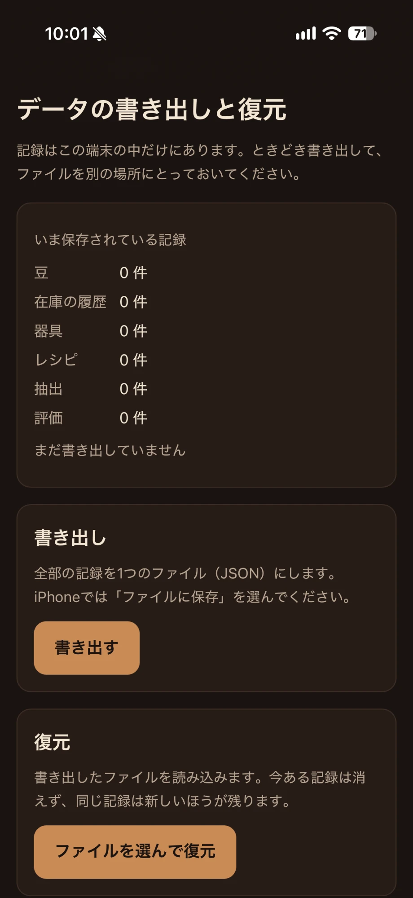
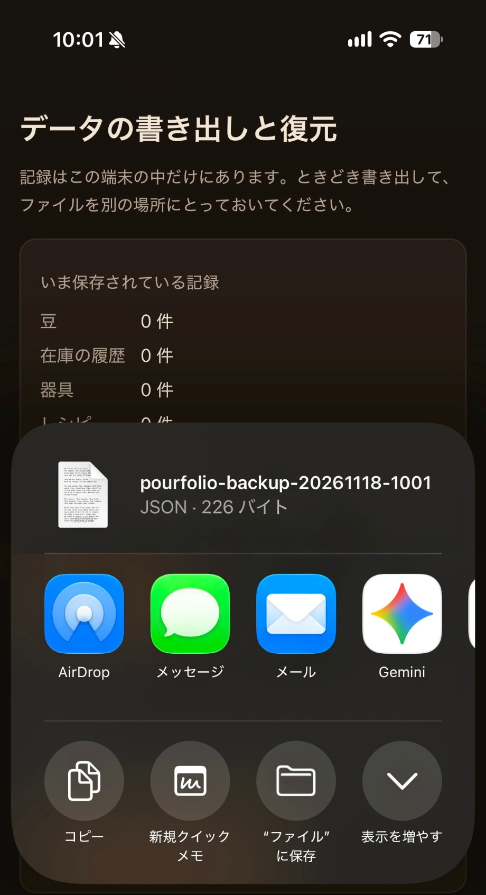
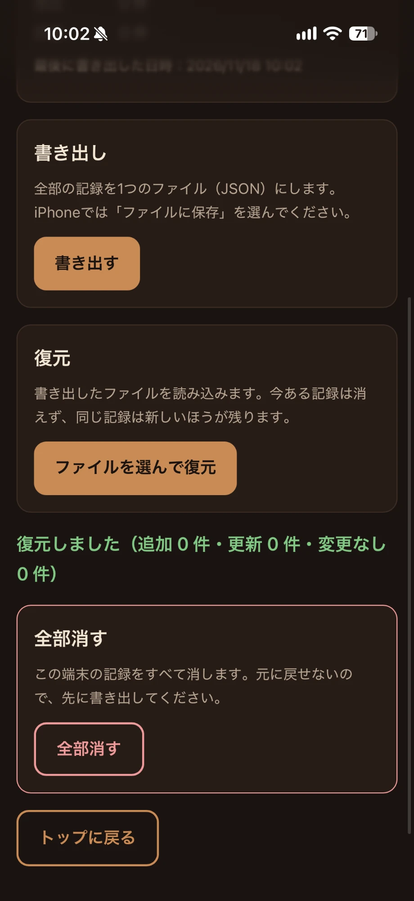

# 7. 書き出し・復元（バックアップ）

記録をファイルに書き出してとっておき、必要なときにそのファイルから戻します。

## 書き出す
1. トップ画面で「データの書き出しと復元」を押す
   
2. 「書き出す」を押す
3. 出てきたメニューで「"ファイル"に保存」を押す
   
4. 保存先（「iCloud Drive」など）を選び、右上の「保存」を押す
5. 画面に「書き出しました」と出て、「最後に書き出した日時」が今の日時になれば完了

## 復元する
1. トップ画面で「データの書き出しと復元」を押す
2. 「ファイルを選んで復元」を押す
3. メニューが出たら「ファイルを選択」を押す
4. 書き出したファイル（名前は `pourfolio-backup-日付-時刻.json`）を押す
5. 「…を復元します。よろしいですか？」と出たら「OK」を押す
6. 「復元しました（追加○件・更新○件・変更なし○件）」と出て、件数が戻っていれば完了
   

## コツ
- 豆を登録したときや、何杯か記録したあとなど、こまめに書き出しておくと安心です
- 保存先を「iCloud Drive」にしておくと、iPhoneをなくしても残ります
- 同じファイルを2回復元しても、記録は増えません

## 注意
- 復元しても今ある記録は消えません。同じ記録がファイルとiPhoneの両方にあるときは、あとから直したほうが残ります
- 「全部消す」を押すと、このiPhoneの記録がすべて消え、元に戻せません。押す前に必ず書き出してください
- Pourfolio以外のファイルや、壊れたファイルを選ぶと、理由が表示されて何も変わりません
- 記録が1件もないときに書き出したファイルを選ぶと、「このファイルには記録が入っていませんでした」と出て何も変わりません
